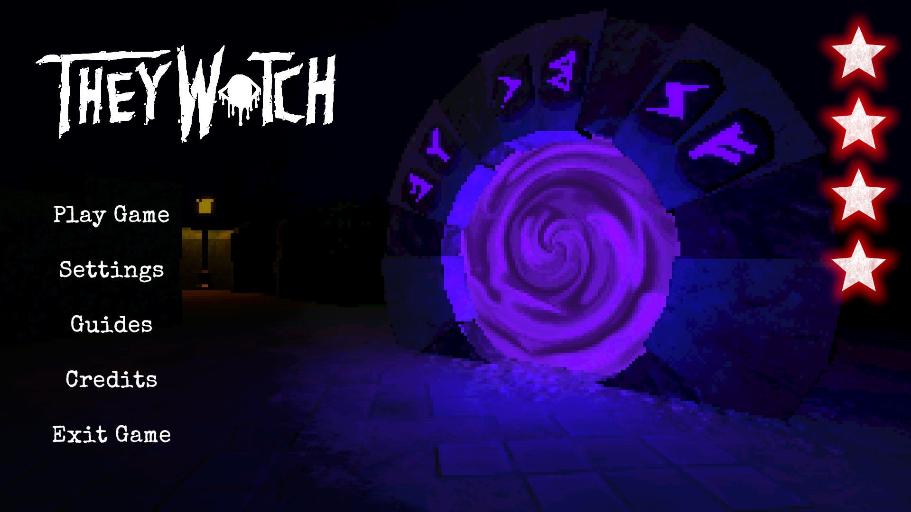
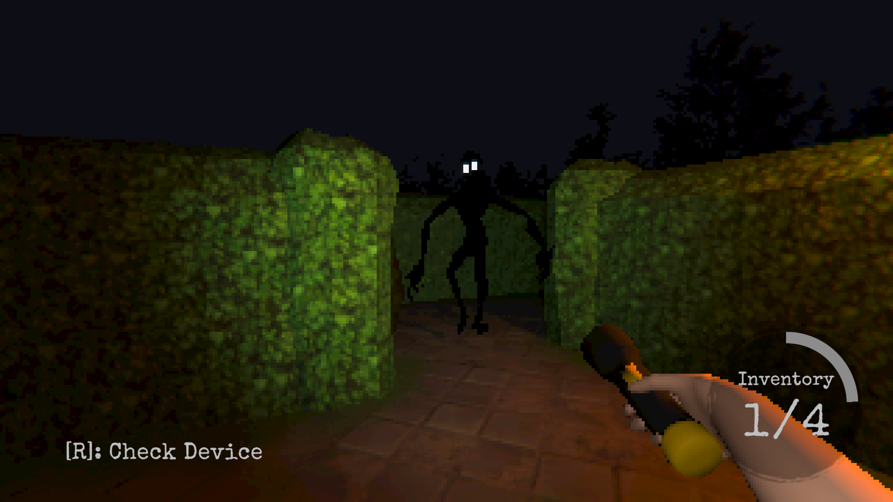
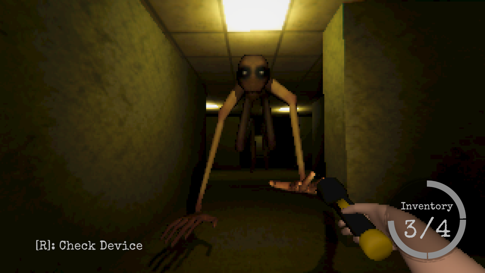
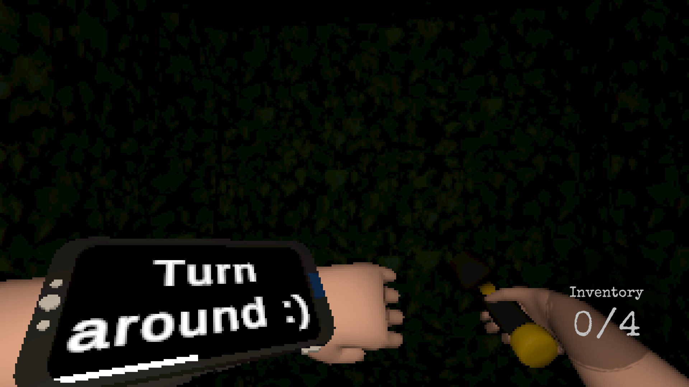
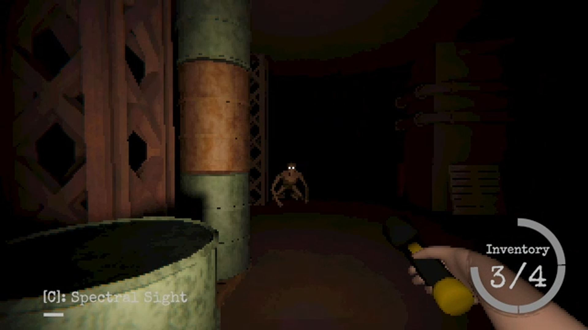

# They Watch

**Description**: They Watch is a first-person, maze-based horror game where the player searches for runestones while dealing with entities that have their own behaviors and counters. It was my first published game.

**Details**: Unity/C#, scripts-only repository

**Development Timeline**: January 2025 - November 2025, with updates after launch

**Released on Steam**: November 19, 2025

  

**[Play the free demo on Steam](https://store.steampowered.com/app/3879000/They_Watch/)**

If you want to try the full game, send me an email at support@ccgstudiogames.com and I'll send you a steam key for free :)

The Steam page also includes the full game, two trailers, additional screenshots, and a complete description. This repository only contains the scripts I wrote and no other assets or plugins that were used in the project.

## Gameplay

The goal is to find the runestones scattered throughout each maze and bring them back to the portal to escape. Your inventory has limited space, so collecting them involves making trips through the maze while learning how to deal with the entities that live there.

A wrist device helps you locate runestones, track how many remain, and find your way back to the portal. It also receives occasional messages from an unknown sender.

The game features four mazes, each with different entities and mechanics, plus hard-mode variants with additional challenges. It supports keyboard and mouse controls as well as full gamepad support, with remappable controls and adjustable graphics and gameplay settings.

| Shade | Stitch |
| :---: | :---: |
|  |  |

| Wrist device messages | Scrapling |
| :---: | :---: |
|  |  |

## Code Tour

### Stalking and enemy behavior

[StalkState.cs](Scripts/Entities/NonPlayerEntities/BehaviorLogic/WayPointDependentLogic/Stalk/StalkState.cs) is one of the systems I'm most proud of. It scores potential waypoints using several inputs:

- Whether the waypoint is outside the player's camera view
- Whether it is behind cover
- Its distance from the player
- Its potential for an ambush based on the player's movement and look direction
- The risk of exposing the entity while repositioning
- A bonus for the shortest navigable path to the player

Passive behavior gives more weight to remaining hidden, while aggressive behavior emphasizes proximity and ambush opportunities. The selection also includes a configurable chance of choosing the second-highest scoring waypoint, which introduces unpredictability while keeping the movement tied to the scoring system.

[StalkPlayer.cs](Scripts/Entities/NonPlayerEntities/BehaviorLogic/WayPointDependentLogic/Stalk/StalkPlayer.cs) puts those decisions into motion. It handles movement, pauses, repositioning near the player, and becoming more aggressive over time.

For the broader behavior structure, [EntityStateMachine.cs](Scripts/Entities/NonPlayerEntities/StateMachine/EntityStateMachine.cs) handles entering and exiting states. Individual monsters combine these behaviors with their own reactions and counters.

### Settings and the graphics menu

[SettingsManager.cs](Scripts/Settings/SettingsManager.cs) applies and stores settings such as resolution, window mode, quality, VSync, frame rate limits, and pixelation. The pixelation setting changes the render texture resolution while accounting for the screen's aspect ratio, meaning the rendered image doesn't get stretched or squished because someone is using a 21:9 aspect ratio instead of a 16:9 aspect ratio.

The menu uses [GraphicsSetting.cs](Scripts/UI/Graphics/GraphicsSetting.cs) as a shared contract for individual settings. Each setting can report whether it has changed and apply its own value.

[GraphicsSettingsController.cs](Scripts/UI/Graphics/GraphicsSettingsController.cs) collects pending changes in a `HashSet` and applies them when the player presses Apply. Returning an option to its current value removes it from the pending changes, and the Apply button is enabled only when changes are queued.

[PixelationSetting.cs](Scripts/UI/Graphics/PixelationSetting.cs) is a compact example of how a specific menu control fits into this workflow.

### Player components

I split the player functionality into separate components for movement, looking, interactions, inventory, health, animations, and audio to make individual systems easier to edit and allow me to enable or disable specific behavior without disabling the entire player (e.g., disabling movement while leaving inventory and health untouched).

Useful starting points include:

- [PlayerMovement.cs](Scripts/Entities/Player/PlayerComponents/PlayerMovement.cs): walking, sprinting, crouching, and checking clearance before standing up
- [PlayerInventory.cs](Scripts/Entities/Player/PlayerComponents/PlayerInventory.cs): carrying collectables and handing them over to the portal
- [PlayerHealth.cs](Scripts/Entities/Player/PlayerComponents/PlayerHealth.cs) and [PlayerCollisions.cs](Scripts/Entities/Player/PlayerComponents/PlayerCollisions.cs): taking damage, damage effects, and distinguishing a hit from player death

### Gamepad support and rebinding

This was my first game with full gamepad support.

[InputManager.cs](Scripts/Input/InputManager.cs) handles input actions, control scheme changes, gamepad connection events, sensitivity, and saving and loading binding overrides.

[RebindUI.cs](Scripts/UI/Input%26Controls/RebindUI.cs) connects the settings interface to the rebinding process. [DisplayInputAction.cs](Scripts/UI/Input%26Controls/DisplayInputAction.cs) updates gameplay prompts when the active control scheme or binding changes.

### Supporting systems and debugging tools

| Starting point | What to look for |
| --- | --- |
| [Radar.cs](Scripts/Objects/PlayerObjects/WristDevice/Radar.cs) | Mapping nearby collectable positions onto the wrist device's radar and reusing ping objects. |
| [StalkStateEditor.cs](Scripts/Editor/StalkStateEditor.cs) | Scene view visualizations of the stalking movement and stopping ranges. |
| [DebugWayPointStalkScore.cs](Scripts/EditorOnly/DebugWayPointStalkScore.cs) | Displaying waypoint scores in the editor to help inspect and tune stalking decisions. |

## Looking Back

### Working at a larger scale

They Watch was a much bigger project than my previous games. I had to manage enemy behaviors, player components, inventory, input, settings, scene transitions, and the ways those systems interacted.

It also changed how I documented my work. In my smaller games, I could keep much of the project in my head so I didn't really document the code very much. With They Watch, I needed comments/summaries that explained why something worked a certain way, what another system expected, and what a method was responsible for.

Alongside programming, I created most of the game's assets, including 3D models and animations, as well as some sound effects and music. Working across those areas helped me understand how changes to art, animation, and audio could affect the code.

### What I would structure differently

Some of my earlier architecture decisions became harder to work with as the project grew. I put useful functionality into classes that were too specific, which limited reuse and contributed to repeated code.

One example is the `LookAtTarget(...)` method in [EntityState.cs](Scripts/Entities/NonPlayerEntities/StateMachine/EntityState.cs). Its rotation behavior could have lived outside the state hierarchy so other systems could use the same implementation.

I also relied too heavily on deep inheritance in parts of the enemy behavior system. The chain `EntityState → EntityWayPointState → StalkState → StalkPlayer` meant that creating a concrete state required understanding behavior spread across several parent classes.

In a future project (as I created this updated README I'm working on PawnShop where I'm addressing these issues), I would give waypoint selection, scoring, and general movement helpers clearer boundaries, with smaller states using those pieces. The player components and graphics settings gave me examples of separation that I would like to build on.

### Balancing after release

Balancing the game was one of the hardest parts of the project. The game itself and the levels were too difficult on launch, and player feedback made that clear.

One player suggested adding health, and I liked the idea. I implemented a health system in a post-launch update to make the game more forgiving.

That update became an important part of the project for me. I had finished and released the game, but feedback from people playing it still led me to change a core mechanic.
